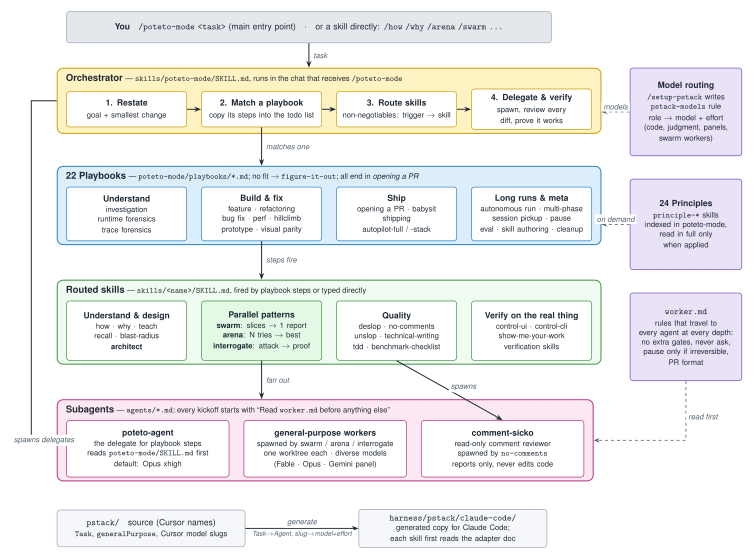

# nevarch

A multi-agent workflow toolkit, starting from an unmodified copy of
[pstack](https://github.com/cursor/plugins/tree/main/pstack) by Lauren Tan.

## Layout

- `pstack/` — the pstack Cursor plugin (skills, agents, playbooks, docs), copied as-is.
- `harness/pstack/` — the generated Claude Code adapter for pstack, copied as-is.
- `pstack/skills/{deslop,control-ui,control-cli}` — bundled from [cursor-team-kit](https://github.com/cursor/plugins/tree/main/cursor-team-kit) so pstack has no external plugin dependency.

## Architecture



- **Orchestrator.** `/poteto-mode` runs in your chat. It restates the goal, matches the task to a playbook, routes skills as the playbook's steps fire, and owns every subagent it spawns.
- **Playbooks.** 22 recipes, one per kind of task. A task no playbook fits goes to `figure-it-out`, and every playbook ends in *opening a PR*.
- **Routed skills.** Single-purpose skills that playbook steps call, or that you type directly. The parallel patterns (`swarm`, `arena`, `interrogate`) are the multi-agent core.
- **Subagents.** `poteto-agent` delegates read `poteto-mode` first. The parallel patterns spawn general-purpose workers, each in its own worktree. `comment-sicko` reviews comments and never edits code.
- **Shared context.** `/setup-pstack` maps each role to a model. The 24 principles are read only when applied. `worker.md` carries the operator's rules to every agent at every depth.

The diagram source is [`docs/architecture/skills-architecture.tex`](docs/architecture/skills-architecture.tex) (TikZ). To rebuild the SVG after editing it:

```bash
cd docs/architecture
pdflatex -output-directory=/tmp skills-architecture.tex
pdftocairo -svg /tmp/skills-architecture.pdf skills-architecture.svg
```

## Provenance

Imported from [`cursor/plugins`](https://github.com/cursor/plugins) at commit
`e1cc03121a0e71129a4fb730d7c5528a0a3e43c8` (pstack v0.15.43).
See [NOTICE](NOTICE).

## License

MIT — see [LICENSE](LICENSE).
